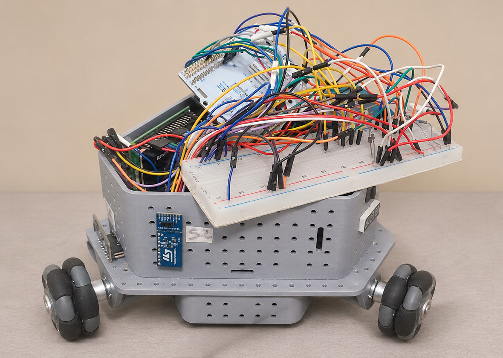

# Omniwheel ToF Sensing

Multi-sensor distance sensing for an omniwheel robot using **VL53L5CX Time-of-Flight sensors**, an **STM32 NUCLEO-H533RE**, and a **Raspberry Pi 5**. This semester project implements sensor acquisition, SPI data transfer, and publication of distance measurements through **ROS 2**.

The [sensing setup](docs/RASP_PI_5_docs/TOF_STM32_SPI/README_VL53L5CX_STM32_RPI_SPI_ROS2.md) is designed to measure distances to nearby obstacles from several directions around the robot. Each sensor provides an 8 × 8 grid of distance values. The STM32 collects these frames and transfers them to the Raspberry Pi, where packet integrity is checked before the measurements are published on a separate ROS 2 topic for each sensor.



```text
VL53L5CX sensors → I2C → STM32H533RE → SPI → Raspberry Pi 5 → ROS 2 topics
```

## Demo

**[Watch the integrated ROS 2 demo](docs/RASP_PI_5_docs/TOF_STM32_SPI/Demo/3_Ros2_puplisch_sensor_data_sensor1_3_4_komprimiert.mp4)**

The recording shows the robot hardware, received sensor data, and live `ros2 topic echo` output. It demonstrates the complete sensing and ROS 2 publishing chain.

## What was achieved

- Initialized multiple VL53L5CX sensors and assigned individual I2C addresses.
- Implemented STM32 firmware for sensor management and DMA-based SPI transfer to the Raspberry Pi.
- Implemented Python receivers with CRC-16 validation of received packets.
- Demonstrated publication of measurements from sensors **1, 3, and 4** to separate ROS 2 topics.

## ROS 2 integration

The [demonstration node](docs/RASP_PI_5_docs/TOF_STM32_SPI/scripts/spi_3_tof_ros_functional_sensor_1_3_4.py) receives SPI data, rejects all-zero packets and packets with an invalid CRC, and publishes the sensor measurements:

| Sensor | Topic | Message type |
| --- | --- | --- |
| 1 | `/sensor_1_data` | `std_msgs/msg/String` |
| 3 | `/sensor_3_data` | `std_msgs/msg/String` |
| 4 | `/sensor_4_data` | `std_msgs/msg/String` |

Each message contains **64 comma-separated distance values**, corresponding to an 8 × 8 sensor frame.

## Keyboard control

The project also includes ROS 2 keyboard control of the robot. The [keyboard node](RASP_PI_5/ROS2_TELEOP_CONTROLLER/keyboard_teleop.py) publishes forward, backward, and rotation commands on `/cmd_vel` using `geometry_msgs/msg/Twist`. The [serial controller](RASP_PI_5/ROS2_TELEOP_CONTROLLER/serial_robot_controller.py) receives these commands on the Raspberry Pi and forwards them to the robot over a serial connection.

## Code and documentation

| Location | Contents |
| --- | --- |
| [CE_POD_TOF](CE_POD_TOF/) | STM32 project, sensor initialization, and SPI/DMA firmware |
| [RASP_PI_5](RASP_PI_5/) | Raspberry Pi SPI receivers, serial tests, and ROS 2 keyboard teleoperation |
| [STM32, SPI, and ROS 2 documentation](docs/RASP_PI_5_docs/TOF_STM32_SPI/README_VL53L5CX_STM32_RPI_SPI_ROS2.md) | Hardware setup, multi-sensor integration, communication tests, and demo videos |
| [ROS 2 teleoperation guide](RASP_PI_5/ROS2_TELEOP_CONTROLLER/ROS2_Setup_and_Configuration_Guide.md) | ROS 2 setup and keyboard-to-serial robot control |

