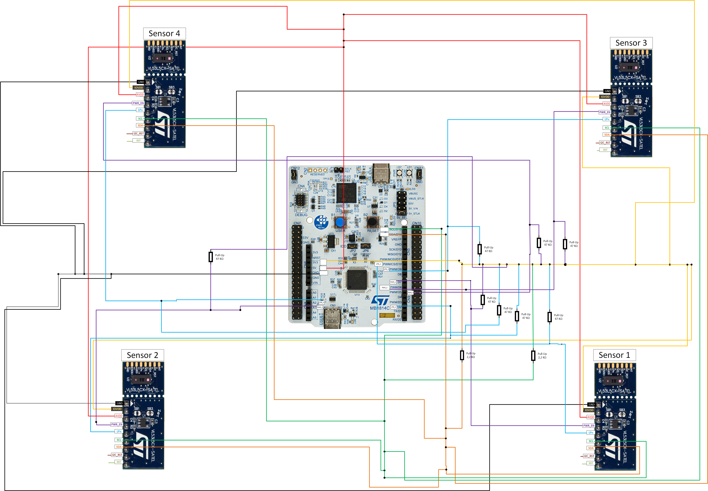

## 1. Project Overview

This README provides a detailed explanation of how to integrate the **VL53L5CX Time-of-Flight sensors** with an **Omniwheel robot**, using both the **Raspberry Pi** and the **STM32 NUCLEO-H533RE** microcontroller.

🎯 **Project Goal:**  
Enable the robot to detect and measure distances to surrounding obstacles in **real time**, using multiple VL53L5CX sensors positioned around the chassis.

To achieve this, the project explores multiple approaches including:

- Sensor placement strategy for 360° coverage
- Optimizing measurement speed using STM32 and ST's X-CUBE-TOF1 software
- Reliable sensor initialization and I2C addressing for multiple units
- SPI-based data transmission from STM32 to Raspberry Pi
- Publishing sensor data via ROS2

This documentation is structured to explain the step-by-step integration, challenges encountered (hardware and software), and the final implementation results including real demos.


## 📑 Table of Contents

- [1. Project Overview](#1-project-overview)
- [📑 Table of Contents](#-table-of-contents)
- [2. Required Number of Sensors for Omniwheel Robot](#2-required-number-of-sensors-for-omniwheel-robot)
  - [🤖 How many sensors are needed?](#-how-many-sensors-are-needed)
  - [✅ Recommended Configurations](#-recommended-configurations)
- [3. Accelerating Measurement Using STM32H533RE](#3-accelerating-measurement-using-stm32h533re)
  - [🧩 X-CUBE-TOF1 Integration with STM32CubeMX](#-x-cube-tof1-integration-with-stm32cubemx)
  - [🔌 Basic Wiring](#-basic-wiring)
- [4. Parameter Tuning for High-Speed Ranging](#4-parameter-tuning-for-high-speed-ranging)
  - [⚙️ Modified Parameters](#️-modified-parameters)
  - [🔧 Recommended Settings for 60 Hz Operation](#-recommended-settings-for-60hz-operation)
  - [🧠 Key Insight](#-key-insight)
- [5. Operating Modes: Continuous vs Autonomous](#5-operating-modes-continuous-vs-autonomous)
  - [🔁 Continuous Mode](#-continuous-mode)
  - [🌙 Autonomous Mode](#-autonomous-mode)
  - [✅ Mode Selection in This Project](#-mode-selection-in-this-project)
  - [⏱️ Performance Comparison: STM32 vs Raspberry Pi](#️-performance-comparison-stm32-vs-raspberry-pi)
- [6. Connecting and Managing Multiple Sensors](#6-connecting-and-managing-multiple-sensors)
  - [🧠 Software Adjustment for Multi-Sensor Use](#-software-adjustment-for-multi-sensor-use)
  - [📁 Custom Driver Modifications](#-custom-driver-modifications)
- [7. VL53L5CX Wiring and Pull-Up Notes](#7-vl53l5cx-wiring-and-pull-up-notes)
  - [🔧 Sensor Wiring Diagram](#-sensor-wiring-diagram)
  - [📌 Important Notes](#-important-notes)
- [8. Transferring Data via SPI from STM32 to Raspberry Pi](#8-transferring-data-via-spi-from-stm32-to-raspberry-pi)
  - [🧭 SPI Design Choice](#-spi-design-choice)
  - [📊 Maximum SPI Frequencies (STM32 Slave Mode)](#-maximum-spi-frequencies-stm32-slave-mode)
  - [⚙️ STM32 SPI Configuration Notes](#️-stm32-spi-configuration-notes)
- [9. SPI Hardware Limitations on Raspberry Pi](#9-spi-hardware-limitations-on-raspberry-pi)
  - [🔒 DMA Limitation](#-dma-limitation)
  - [⚠️ Practical Impact](#️-practical-impact)
  - [🧠 Observations](#-observations)
  - [🚫 Additional Limitation: I2C Bus Contention](#-additional-limitation-i2c-bus-contention)
- [10. Final SPI Configuration and Working Setup](#10-final-spi-configuration-and-working-setup)
  - [🧩 Final Decision](#-final-decision)
  - [✅ Advantages of Final Setup](#-advantages-of-final-setup)
  - [🧪 Real-World Test Results](#-real-world-test-results)
- [11. Initial Demo: Dual Sensor SPI Setup](#11-initial-demo-dual-sensor-spi-setup)
  - [🎥 Live Demo Overview](#-live-demo-overview)
  - [🛠️ Purpose of This Demo](#️-purpose-of-this-demo)
- [12. SPI Communication Performance Test](#12-spi-communication-performance-test)
  - [🎥 Test Video: SPI Performance Measurement](#-test-video-spi-performance-measurement)
  - [🧪 Test Configuration](#-test-configuration)
  - [📊 Results Summary](#-results-summary)
- [13. ROS2 Sensor Data Publishing via SPI](#13-ros2-sensor-data-publishing-via-spi)
  - [🚀 ROS 2 Integration Overview](#-ros-2-integration-overview)
  - [🎥 Demo Video: Live ROS 2 Publishing](#-demo-video-live-ros-2-publishing)
- [14. Sensor Limitations on Shared I2C Bus](#14-sensor-limitations-on-shared-i2c-bus)
  - [📌 Observations from Real-World Testing](#-observations-from-real-world-testing)
  - [🔧 Practical Recommendation](#-practical-recommendation)
- [15. Conclusion](#15-conclusion)
  - [✅ Achievements](#-achievements)
  - [⚠️ Limitations Observed](#️-limitations-observed)
- [16. Outlook / Future Work](#16-outlook--future-work)
  - [🚀 Planned Improvements](#-planned-improvements)
- [📚 References \& Resources](#-references--resources)
  - [📄 STMicroelectronics Documentation](#-stmicroelectronics-documentation)
  - [💬 Raspberry Pi Forum Discussions](#-raspberry-pi-forum-discussions)
  - [📽️ Demonstration Videos](#️-demonstration-videos)
  - [🧪 GitLab Commits](#-gitlab-commits)


## 2. Required Number of Sensors for Omniwheel Robot

To enable full environmental awareness, the robot must detect obstacles in all directions — ideally covering a complete 360° field of view (FoV). Each **VL53L5CX** sensor has the following effective detection angles (based on its System FoV):

| Direction  | Field of View |
| ---------- | ------------- |
| Horizontal | 45°           |
| Vertical   | 45°           |
| Diagonal   | 65°           |

📌 **Note:** Although the exclusion zone (used for mechanical design) spans up to **82° diagonally**, the actual usable detection area is limited to **65° diagonal**.  
📖 Source: [VL53L5CX Datasheet – p.4](https://www.st.com/resource/en/datasheet/vl53l5cx.pdf)

---

### 🤖 How many sensors are needed?

To calculate the minimum number of sensors for 360° coverage:

```
360° / 65° ≈ 5.54
```

➡️ **At least 6 VL53L5CX sensors** are required to cover the entire area with slight overlap between sensors to avoid blind spots.

---

### ✅ Recommended Configurations

| Coverage Goal                  | Recommended Sensor Count |
| ------------------------------ | ------------------------ |
| Full 360° detection            | 6                        |
| High-precision with redundancy | 8                        |
| Frontal + side monitoring only | 3–4                      |

Sensors should be placed symmetrically around the robot’s perimeter for optimal coverage. Each sensor will require a unique I2C address and control logic, which is covered in later sections.


## 3. Accelerating Measurement Using STM32H533RE

To achieve faster and more efficient distance measurements than with the Raspberry Pi, the **STM32H533RETx** microcontroller was selected. It supports the **X-CUBE-TOF1** software package provided by STMicroelectronics, which enables direct integration of the **VL53L5CX** sensor.

### 🧩 X-CUBE-TOF1 Integration with STM32CubeMX

To begin the setup, a single VL53L5CX sensor was connected to the STM32 board using I2C. The **X-CUBE-TOF1 package** was then imported into STM32CubeMX to generate the initialization and driver code.

📖 Official resource:  
[ST X-CUBE-TOF1 Overview](https://www.st.com/en/evaluation-tools/vl53l5cx-satel.html#overview)  
User manual (UM2974), pages 37–44:  
[How to use VL53L5CX with STM32Cube](https://www.st.com/resource/en/user_manual/um2974-how-to-use-the-vl53l5cx-with-stmicroelectronics-xcubetof1-timeofflight-sensor-software-packages-for-stm32cubemx-stmicroelectronics.pdf)

---

### 🔌 Basic Wiring

> 🛠️ Note: When connecting **only one sensor**, external pull-up or pull-down resistors are **not required**. These are necessary only for multi-sensor setups.

Below is the wiring diagram of a single VL53L5CX connected to STM32H533RE:


---

Next, the project parameters were modified to improve performance. The timing budget and ranging frequency were specifically tuned to operate the sensor in a fast-response mode.


## 4. Parameter Tuning for High-Speed Ranging

To enable high-speed distance measurements, key sensor configuration parameters were modified from their default values. These adjustments significantly reduced measurement latency while keeping the sensor within its operational constraints.

### ⚙️ Modified Parameters

The following parameters were changed in the firmware:

```c
//#define TIMING_BUDGET (30U) /* 5 ms < TimingBudget < 100 ms */
#define TIMING_BUDGET (16U)  /* 5 ms < TimingBudget < 100 ms */
//#define RANGING_FREQUENCY (10U) /* Hz */
#define RANGING_FREQUENCY (60U)  /* Hz */
//#define POLLING_PERIOD (1)
#define POLLING_PERIOD (5)
```

📌 **Note:** The maximum allowed ranging frequency for the VL53L5CX is **60 Hz**, as specified in the [VL53L5CX Datasheet (p. 2)](https://www.st.com/resource/en/datasheet/vl53l5cx.pdf).

---

### 🔧 Recommended Settings for 60 Hz Operation

| Parameter            | Recommended Value | Reason                                                                 |
|----------------------|-------------------|------------------------------------------------------------------------|
| `TIMING_BUDGET`      | 16 ms             | Fits within the time slot of 1000 ms / 60 Hz ≈ 16.7 ms per scan       |
| `RANGING_FREQUENCY`  | 60 Hz             | Highest supported frequency for fastest measurements                   |
| `POLLING_PERIOD`     | 5 ms              | Set shorter than scan period to ensure timely polling                  |

---

### 🧠 Key Insight

It is critical that the **`TIMING_BUDGET` and `RANGING_FREQUENCY` remain consistent**. For instance, if the timing budget exceeds the allowed time per scan, the sensor will not be able to maintain the specified frequency.

These settings configure the sensor in **fast mode**, which is optimal for real-time applications like obstacle detection in robotics.


## 5. Operating Modes: Continuous vs Autonomous

The **VL53L5CX Time-of-Flight sensor** supports two primary operating modes for distance measurement:

### 🔁 Continuous Mode

- The sensor performs measurements **continuously** at a user-defined frequency.
- The **VCSEL (laser)** remains **active throughout** the measurement cycle.
- Offers **maximum range and stability**, even in challenging lighting conditions.
- Best suited for **real-time applications** where fast reaction times are critical.
- ⚡ Higher power consumption due to constant laser activity.

### 🌙 Autonomous Mode

- Default mode when initializing the sensor.
- The sensor performs measurements at the specified frequency, but:
  - The **VCSEL is only activated** for a short **integration time**.
- Significantly reduces power consumption, especially at low measurement frequencies.
- Ideal for **battery-powered systems** or energy-sensitive use cases.
- Typical applications: **presence detection**, **low-frequency monitoring**, etc.

📖 Source:  
[ST User Manual: Ultra Lite Driver Guide (UM2974)](https://www.st.com/resource/en/user_manual/dm00797144-a-guide-to-using-the-vl53l5cx-multizone-timeofflight-ranging-sensor-with-wide-field-of-view-ultra-lite-driver-uld-stmicroelectronics.pdf), p. 9

---

### ✅ Mode Selection in This Project

Since the goal is to achieve **real-time distance measurement**, the project uses the **Continuous Mode**.

This mode provides:

- The **fastest response time**
- Consistent and **high-frequency readings**
- Better support for robotic applications with real-time feedback loops

---

### ⏱️ Performance Comparison: STM32 vs Raspberry Pi

After switching to Continuous Mode and tuning the parameters accordingly, the system was tested for **1000 ranging cycles** using both **4×4** and **8×8** zone configurations.

The results were impressive:

- **4×4 Matrix Result:**  
  🕒 **9,384 ms** total for 1000 scans  
  ➕ Nearly **2× faster** than the Raspberry Pi (which took **16.8 seconds**)  
  🔗 [View Commit](https://gitlab.rz.htw-berlin.de/kerdels/ce_pod/-/tree/a874c21468ba7b79e5667749e96c47a7c548bddd)

- **8×8 Matrix Result:**  
  🕒 **13,460 ms** total for 1000 scans  
  ➕ Approximately **5× faster** than the Raspberry Pi (which required **64 seconds**)  
  🔗 [View Commit](https://gitlab.rz.htw-berlin.de/kerdels/ce_pod/-/tree/f8d1083ac61a29e9e3047e5e736a5a4f709586d1)

> ✅ These results confirm that the STM32 implementation in Continuous Mode offers a **significant performance boost** and is suitable for real-time operation.


## 6. Connecting and Managing Multiple Sensors

To connect multiple VL53L5CX sensors to the same STM32 microcontroller, several hardware and software considerations must be addressed.

---

### 🧠 Software Adjustment for Multi-Sensor Use

The ST-provided **X-CUBE-TOF1 library** is built for **single-sensor use** only.

To support multiple VL53L5CX modules, the application must be adapted so that **each sensor instance uses its own independent data structure**. Otherwise:

- A second sensor initialization fails because it **reuses the same internal memory**.
- The `is_initialized` flag in the driver remains `true`, causing all following inits to abort.

---

### 📁 Custom Driver Modifications

To avoid this issue, a custom folder called `User` was added to the project:
```
/CE_POD_TOF/Core/Src/User
```

This folder contains modified drivers with **clean separation per sensor instance**, allowing each sensor to operate independently without overwriting shared state.

📎 See commit:  
https://gitlab.rz.htw-berlin.de/kerdels/ce_pod/-/tree/e1f3e7200dd27f6a4f3d2103f39dffe6e2ea1ec0

---

In the following section, the full wiring layout for **four VL53L5CX sensors** connected to the STM32 NUCLEO-H533RE is described.


## 7. VL53L5CX Wiring and Pull-Up Notes

The following diagram illustrates how four **VL53L5CX-SATEL sensors** are connected to the **STM32 NUCLEO-H533RE** board.

Each sensor requires:

- I2C lines (shared)
- Individual `PWR_EN` and `LPN` GPIOs
- Unique I2C address configuration
- Proper pull-up resistors on key lines

---

### 🔧 Sensor Wiring Diagram

<figure style="text-align: center;">
  
  <figcaption style="font-style: italic; margin-top: 0.5em;">
    Figure 2: Wiring diagram for four VL53L5CX sensors and STM32 NUCLEO-H533RE
  </figcaption>
</figure>

---

### 📌 Important Notes

- **Pull-up resistors** must be added per sensor on:
  - `PWR_EN` (e.g., 47 kΩ to 3.3 V)
  - `LPN` (e.g., 47 kΩ to 3.3 V)
- **SCL/SDA** lines must also include pull-ups (e.g., 2.2 kΩ)
- **Address configuration:** Each sensor must be assigned a **unique I2C address** to operate on the same bus.
⚠️ These pull-ups are **not required** if using **only one sensor**.

---

> 🖼️ *Note:* For full detail and readability, open the wiring diagram in a separate window and zoom in if necessary.


## 8. Transferring Data via SPI from STM32 to Raspberry Pi

To transmit the measured distance data from the **STM32** to the **Raspberry Pi**, the **SPI bus** was chosen due to its significantly higher throughput compared to I2C or UART.

---

### 🧭 SPI Design Choice

- The Raspberry Pi operates as **SPI master**
- The STM32 is configured as **SPI slave**
- **DMA (Direct Memory Access)** is enabled on the STM32 side to offload the CPU and improve efficiency

---

### 📊 Maximum SPI Frequencies (STM32 Slave Mode)

The STM32H533CE supports different SPI clock speeds depending on the operating voltage and whether it is transmitting or receiving data:

| Mode                    | VDD Range         | Max SPI Clock           |
|-------------------------|-------------------|--------------------------|
| **Slave Receiver Mode** | 1.71 V – 3.6 V     | **120 MHz**             |
| **Slave Transmitter Mode** | 2.7 V – 3.6 V  | **43 MHz**<sup>(3)</sup> / **6 MHz**<sup>(4)</sup> |
| **Slave Transmitter Mode** | 1.71 V – 2.7 V | **41.5 MHz**<sup>(3)</sup> / **6 MHz**<sup>(4)</sup> |

✅ In this project, STM32 operates as a **SPI Slave Receiver**, and the selected SPI clock of **30 MHz** is well within the allowed range.  
This ensures **stable high-speed SPI communication** for real-time sensor data transfer.

📖 Source: [STM32H533CE Datasheet – Table 110, p.189](https://www.st.com/resource/en/datasheet/stm32h533ce.pdf)

---

### ⚙️ STM32 SPI Configuration Notes

- **DMA with 8-word transfer length** is used to send data from multiple sensors in a single transmission
- Ensure correct `DataWidth` settings are applied after `HAL_SPI_MspInit()`:
  ```c
  hspi1.hdmarx->Init.DestDataWidth = DMA_DEST_DATAWIDTH_WORD;
  hspi1.hdmatx->Init.DestDataWidth = DMA_DEST_DATAWIDTH_WORD;
  ```
- SPI must be fully configured before calling:
  ```c
  HAL_SPI_TransmitReceive_DMA(...)
  ```

---

The SPI interface on the STM32 and Raspberry Pi was tested using **SPIDev** on the Pi side and a custom Python script.  
Initial tests used **SPI1**, but attempts to parallelize using **SPI0 and SPI1** failed due to Raspberry Pi hardware limitations.

To ensure reliability, the final design uses **a single SPI bus with DMA**, aggregating data from all sensors on the STM32 before sending it to the Raspberry Pi.


## 9. SPI Hardware Limitations on Raspberry Pi

During testing, several important hardware limitations were discovered regarding the Raspberry Pi’s SPI interface, especially when using **multiple SPI buses in parallel**.

---

### 🔒 DMA Limitation

The Raspberry Pi has **only one hardware DMA engine** dedicated to SPI. This leads to critical limitations:

- **Only one SPI bus** (e.g. `SPI0` or `SPI1`) can use DMA at a time
- When trying to use **both SPI buses simultaneously**, communication becomes unreliable
- This affects both `spidev0.0` and `spidev1.0` if accessed in parallel

📖 Source:  
- https://forums.raspberrypi.com/viewtopic.php?t=361457  
- https://forums.raspberrypi.com/viewtopic.php?t=310816
---

### ⚠️ Practical Impact

- When two SPI interfaces are used with **DMA**, one of them will fail silently or not respond
- If DMA is disabled, the second SPI bus may work using **interrupt or polling mode**, but at **significantly reduced speed**
- For high-speed communication (e.g. **16-bit transfers with large buffers**), only one bus can be used efficiently

---

### 🧠 Observations

- While the STM32 side could handle two SPI channels, the **Raspberry Pi cannot receive on both using DMA**
- The fallback (using interrupts) was not reliable for real-time sensor updates
- Only **one SPI connection with DMA** remained stable across all tests


---

### 🚫 Additional Limitation: I2C Bus Contention

Another issue arose when multiple VL53L5CX sensors shared the same `I2C1` bus:

- The I2C controller sets a `BUSY` flag when the bus is occupied
- As long as `BUSY = 1`, **no new communication** can begin
- This prevents **parallel I2C communication** with multiple sensors

📖 ST Reference Manual (RM0481):  
> *"To launch the communication, set the START bit of the I2C_CR2 register. The controller then automatically sends a START condition followed by the target address, either immediately if the BUSY flag is low, or tBUF time after the BUSY flag transits from high to low state. The BUSY flag is set upon sending the START condition."*  
(Source: [RM0481, p. 2094 and 2129](https://www.st.com/resource/en/reference_manual/rm0481-stm32h52333xx-stm32h56263xx-and-stm32h573xx-armbased-32bit-mcus-stmicroelectronics.pdf))

👉 **Solution:**  
To allow concurrent sensor access, a **second I2C bus** should be configured. However, this does **not solve the SPI limitation** on the Raspberry Pi side (only one SPI-DMA channel is available, as explained above).

---

> ✅ As a result, the final system uses **only one SPI bus (with DMA)** between STM32 (slave) and Raspberry Pi (master), with sensors accessed **sequentially** via I2C.


## 10. Final SPI Configuration and Working Setup

After evaluating several hardware limitations and DMA conflicts, the final system configuration was adjusted for **maximum reliability** and **real-time performance**.

---

### 🧩 Final Decision

- Only **one SPI bus** is used between **STM32 (slave)** and **Raspberry Pi (master)**
- Communication is handled using **DMA on the STM32 side**
- Sensor data from **multiple VL53L5CX units** is collected sequentially over I2C and then **transmitted in one SPI block** to the Raspberry Pi

---

### ✅ Advantages of Final Setup

- **Stable SPI communication** at high speed (tested at 30 MHz)
- **Efficient DMA transfer** minimizes CPU load on the STM32
- **Data aggregation** from all sensors into a single SPI transaction
- Compatible with **SPIDev** and Python on Raspberry Pi
- Avoids all known issues with:
  - DMA contention
  - SPI bus conflicts
  - I2C `BUSY` access blocking

---

### 🧪 Real-World Test Results

- Four VL53L5CX sensors were initialized successfully
- Sensor data was read via I2C and packaged in STM32
- SPI transfer to Raspberry Pi occurred every few milliseconds without data loss
- ROS 2 nodes on the Pi successfully received and published the data to separate topics

> 📎 The actual demo and performance statistics are described in the next section.


## 11. Initial Demo: Dual Sensor SPI Setup

Before diving into performance tests and ROS integration, this section demonstrates the **basic setup and operation of two VL53L5CX sensors** connected to an STM32 microcontroller and communicating with a Raspberry Pi over SPI.

---

### 🎥 Live Demo Overview

This video shows:

- The successful **initialization of four sensors**, with two active for measurement
- SPI configuration on both **STM32 (slave)** and **Raspberry Pi (master)**
- How the sensors detect obstacles in front of the robot in **real-time**
- The data being read via a **Python script** on the Raspberry Pi

> 📌 Left side: the physical robot setup and sensor placement (Sensors 3 & 4)  
> 📌 Right side: terminal window running the SPI receiver on the Raspberry Pi

{width=1080 height=620}

📎 If the video does not load automatically, [click here to view or download it](Demo/1_SPI2_SENSOR_3_4_05_03_25_komprimiert.mp4)

---

### 🛠️ Purpose of This Demo

- Validate that the SPI bus is working correctly
- Confirm that the sensor modules respond to environmental changes
- Observe the **initial integration success** before fine-tuning for performance

> ✅ This demo serves as proof-of-concept for the hardware integration and real-time SPI communication pipeline.


## 12. SPI Communication Performance Test

This section demonstrates a detailed **performance analysis** of the SPI communication between the **STM32 microcontroller** and the **Raspberry Pi**, using two VL53L5CX sensors.

---

### 🎥 Test Video: SPI Performance Measurement

This demo shows:

- The STM32 transmitting distance data from sensors 3 and 4 over SPI
- The Raspberry Pi receiving data via Python (using `spidev`)
- CRC validation and real-time throughput tracking
- Logging of valid and invalid packets for quality evaluation

> 🖼️ *Left side:* physical robot with sensors  
> 🖥️ *Right side:* terminal output of the SPI receiver and ROS publisher

{width=1080 height=620}

📎 If the video does not play in preview, [click here to view or download it](Demo/1_SPI2_SENSOR_3_4_05_03_25_komprimiert.mp4).

---

### 🧪 Test Configuration

| Parameter               | Value                    |
|------------------------|--------------------------|
| SPI Frequency          | 30 MHz                   |
| SPI Mode               | Mode 0 (CPOL = 0, CPHA = 0) |
| Word Size              | 16-bit (MSB first)       |
| Buffer Size            | 256 words (512 bytes)    |
| Sensors in Use         | 2 (Sensor 3 and Sensor 4)|
| Transfer Type          | DMA-based SPI            |
| Target Packets         | 1000                     |

---

### 📊 Results Summary

| Metric                         | Value         |
|--------------------------------|---------------|
| Valid Packets Received         | 1000 / 1000   |
| Invalid Packets (Total)        | 64,974        |
| → CRC Errors                   | 59            |
| → Null Packets                 | 64,915        |
| → Duplicate Packets            | 0             |
| Avg. Transfer Time per Packet  | 32,511.71 µs  |
| Total Time for 1000 Packets    | 32.5117 sec   |

---

> ✔️ **Conclusion:** All intended packets were received and validated successfully via CRC.  
> ⚠️ Noise and null packet overheads may occur due to SPI master polling frequency or idle reads.
> The system demonstrated **stable and continuous transfer** under real load
> CRC error rate remained **extremely low**
---
> This test confirms that the system can **reliably handle SPI communication** for sensor data in real time.
Next up: integrating the SPI data into **ROS 2**, allowing the robot to process and react to sensor readings live.


## 13. ROS2 Sensor Data Publishing via SPI

After successfully establishing the SPI communication between STM32 and Raspberry Pi, the next step was to **publish the received distance measurements to ROS 2 topics**.

This enabled the robot to interact with higher-level software systems like SLAM, obstacle avoidance, and real-time visualization.

---

### 🚀 ROS 2 Integration Overview

- A custom **Python ROS 2 node** was implemented on the Raspberry Pi
- It continuously reads SPI packets from the STM32
- Data from each sensor is published to its own topic for modular access

| Sensor ID | ROS 2 Topic Name        |
|-----------|--------------------------|
| Sensor 1  | `/sensor_1_data`         |
| Sensor 3  | `/sensor_3_data`         |
| Sensor 4  | `/sensor_4_data`         |

> ⚠️ **Note:** Sensor 2 was damaged due to an early misconfiguration.  
> While initialization completes, it sends invalid data and causes I2C lock-ups.


---

### 🎥 Demo Video: Live ROS 2 Publishing

This video shows:

- The SPI Python node running on the Raspberry Pi
- Real-time data reception from STM32 over SPI
- ROS 2 topics being updated live
- Sensors reacting to obstacles near the robot

{width=1080 height=620}

📎 If the video does not play, [click here to view or download it](../Zusammenfassung_WS_24_25/3_Ros2_puplisch_sensor_data_sensor1_3_4_komprimiert.mp4)

---


## 14. Sensor Limitations on Shared I2C Bus

Through testing, it became clear that while the basic setup of multiple VL53L5CX sensors on a shared I2C bus was functional, the system encountered stability issues as more sensors were added.

---

### 📌 Observations from Real-World Testing

- With **2 sensors** connected to the same I2C bus, communication was stable and consistent
- Adding a **third sensor** caused **intermittent failures**, and the system occasionally required a **manual I2C bus reset** to recover
- When a **fourth sensor** was connected, communication to that sensor **failed entirely** — the sensor would either return no data or become unresponsive
- These issues were consistently reproducible and were **not related to sensor initialization**

---

### 🔧 Practical Recommendation

> To reliably operate more than 2–3 sensors, it is **strongly recommended** to configure a **second I2C bus** on the STM32.

Using two separate I2C buses allows sensors to be grouped and reduces bus congestion. This leads to:

- Better scalability
- Fewer communication conflicts
- Improved reliability in real-time operation

---

> ✅ The final working setup uses two sensors per I2C bus to ensure high-speed polling and clean data acquisition without instability.


## 15. Conclusion

The project successfully achieved its primary goal: configuring multiple **VL53L5CX ToF sensors** on an **STM32 NUCLEO-H533RE** board and transmitting the measured distances to a **Raspberry Pi 5** via **SPI**. The data was then published to dedicated **ROS 2 topics**, as demonstrated in the accompanying demo videos.

---

### ✅ Achievements

- STM32 was configured to read and manage multiple VL53L5CX sensors
- SPI communication between STM32 (slave) and Raspberry Pi (master) was successfully implemented
- Data transmission and visualization through ROS 2 topics was demonstrated
- The system is already functional for real-time distance sensing

---

### ⚠️ Limitations Observed

- A single **I2C bus** could reliably support only **2 to 3 sensors**
- When connecting a **fourth sensor**, data acquisition became unstable or completely failed
- This limitation likely stems from I2C timing conflicts and hardware constraints, which will be analyzed in future work
- The **Raspberry Pi cannot operate two SPI buses simultaneously with DMA**, as it only supports one SPI DMA engine

---

> ✅ In summary: the setup works reliably with up to 3 sensors, and the architecture using STM32 for sensor management and SPI for communication to the Raspberry Pi is robust. For further expansion, additional I2C buses and optimized SPI routing should be considered.


## 16. Outlook / Future Work

While the current implementation has proven functional and robust for up to 3 sensors, several areas remain for further exploration and system enhancement.

---

### 🚀 Planned Improvements

1. **Full 360° Coverage with 8 Sensors**  
   To fully monitor the environment for the omni-wheel robot, up to 8 VL53L5CX sensors are required.  
   → This will require:
   - Configuration of **multiple I2C buses** on the STM32
   - Careful **distribution of sensors** across buses to avoid collisions
   - Verification of real-time performance with 6–8 sensors

2. **Improved SPI Communication Strategy**  
   Since the Raspberry Pi can only use DMA on **one SPI bus**, parallel SPI transfers are limited.  
   → Options to investigate:
   - **Software-based SPI** for secondary buses
   - **SPI multiplexing** with CS lines
   - Offloading SPI aggregation entirely to STM32

3. **Enhanced ROS 2 Integration**  
   - Implement ROS 2 nodes that **subscribe to sensor topics** and make autonomous decisions (e.g., obstacle avoidance)
   - Add **visualization support** via `rviz2` or `rqt_plot`
   - Optimize **sensor calibration and filtering** within the ROS pipeline

4. **Error Handling and Recovery**  
   - Add automatic I2C **bus reset mechanisms**
   - Monitor sensor status and trigger fallback logic in case of communication loss

5. **Deployment and Testing on Robot**  
   - Mount the sensor array on the omni-wheel robot
   - Run real-world navigation tests
   - Evaluate robustness, latency, and measurement precision under dynamic conditions

---

> 🎯 The long-term goal is to develop a **scalable, real-time, and ROS-integrated sensing system** capable of supporting fully autonomous navigation for the omni-wheel robot using multiple VL53L5CX sensors.


## 📚 References & Resources

This section lists all official documentation, datasheets, PDFs, code repositories, videos, and forum discussions referenced in this project.

---

### 📄 STMicroelectronics Documentation

- **VL53L5CX Datasheet**  
  [https://www.st.com/resource/en/datasheet/vl53l5cx.pdf](https://www.st.com/resource/en/datasheet/vl53l5cx.pdf)  
  ↳ Used for field-of-view angles, max frequency, performance constraints (pages 2, 4)

- **VL53L5CX Evaluation Board (SATEL) Overview**  
  [https://www.st.com/en/evaluation-tools/vl53l5cx-satel.html](https://www.st.com/en/evaluation-tools/vl53l5cx-satel.html)

- **X-CUBE-TOF1 User Manual (UM2974)**  
  [https://www.st.com/resource/en/user_manual/um2974-how-to-use-the-vl53l5cx-with-stmicroelectronics-xcubetof1-timeofflight-sensor-software-packages-for-stm32cubemx-stmicroelectronics.pdf](https://www.st.com/resource/en/user_manual/um2974-how-to-use-the-vl53l5cx-with-stmicroelectronics-xcubetof1-timeofflight-sensor-software-packages-for-stm32cubemx-stmicroelectronics.pdf)  
  ↳ Setup instructions for STM32CubeMX, sensor integration (pages 37–44)

- **Ultra Lite Driver Manual (DM00797144)**  
  [https://www.st.com/resource/en/user_manual/dm00797144-a-guide-to-using-the-vl53l5cx-multizone-timeofflight-ranging-sensor-with-wide-field-of-view-ultra-lite-driver-uld-stmicroelectronics.pdf](https://www.st.com/resource/en/user_manual/dm00797144-a-guide-to-using-the-vl53l5cx-multizone-timeofflight-ranging-sensor-with-wide-field-of-view-ultra-lite-driver-uld-stmicroelectronics.pdf)  
  ↳ Operating modes and sensor performance explanation (page 9)

- **STM32H5 Reference Manual (RM0481)**  
  [https://www.st.com/resource/en/reference_manual/rm0481-stm32h52333xx-stm32h56263xx-and-stm32h573xx-armbased-32bit-mcus-stmicroelectronics.pdf](https://www.st.com/resource/en/reference_manual/rm0481-stm32h52333xx-stm32h56263xx-and-stm32h573xx-armbased-32bit-mcus-stmicroelectronics.pdf)  
  ↳ Explanation of I2C `BUSY` bit behavior and tBUF delay (pages 2094, 2129)

- **STM32H533CE Datasheet**  
  [https://www.st.com/resource/en/datasheet/stm32h533ce.pdf](https://www.st.com/resource/en/datasheet/stm32h533ce.pdf)  
  ↳ SPI electrical characteristics and max frequency specs (page 189, Table 110)

---

### 💬 Raspberry Pi Forum Discussions

- **SPI DMA Limitations and Thread Safety**  
  [https://forums.raspberrypi.com/viewtopic.php?t=361457](https://forums.raspberrypi.com/viewtopic.php?t=361457)  
  [https://forums.raspberrypi.com/viewtopic.php?t=310816](https://forums.raspberrypi.com/viewtopic.php?t=310816)  
  ↳ Important for SPI communication reliability when using multiple buses

---

### 📽️ Demonstration Videos

- **Demo 1 – SPI Setup with Two Sensors**  
  [`1_SPI2_SENSOR_3_4_05_03_25_komprimiert.mp4`](Demo/1_SPI2_SENSOR_3_4_05_03_25_komprimiert.mp4)

- **Demo 2 – SPI Performance Test**  
  [`2_SPI_Laufzeit_Test_SPIdev_SPI0_sensor_3_4_komprimiert.mp4`](Demo/2_SPI_Laufzeit_Test_SPIdev_SPI0_sensor_3_4_komprimiert.mp4)

- **Demo 3 – ROS 2 Publishing of Sensor Data**  
  [`3_Ros2_puplisch_sensor_data_sensor1_3_4_komprimiert.mp4`](Demo/3_Ros2_puplisch_sensor_data_sensor1_3_4_komprimiert.mp4)

---

### 🧪 GitLab Commits

- **Timing Benchmark: 4×4 Matrix**  
  [https://gitlab.rz.htw-berlin.de/kerdels/ce_pod/-/tree/a874c21468ba7b79e5667749e96c47a7c548bddd](https://gitlab.rz.htw-berlin.de/kerdels/ce_pod/-/tree/a874c21468ba7b79e5667749e96c47a7c548bddd)

- **Timing Benchmark: 8×8 Matrix**  
  [https://gitlab.rz.htw-berlin.de/kerdels/ce_pod/-/tree/f8d1083ac61a29e9e3047e5e736a5a4f709586d1](https://gitlab.rz.htw-berlin.de/kerdels/ce_pod/-/tree/f8d1083ac61a29e9e3047e5e736a5a4f709586d1)

- **Modified Multi-Sensor Driver**  
  [https://gitlab.rz.htw-berlin.de/kerdels/ce_pod/-/tree/e1f3e7200dd27f6a4f3d2103f39dffe6e2ea1ec0](https://gitlab.rz.htw-berlin.de/kerdels/ce_pod/-/tree/e1f3e7200dd27f6a4f3d2103f39dffe6e2ea1ec0)

